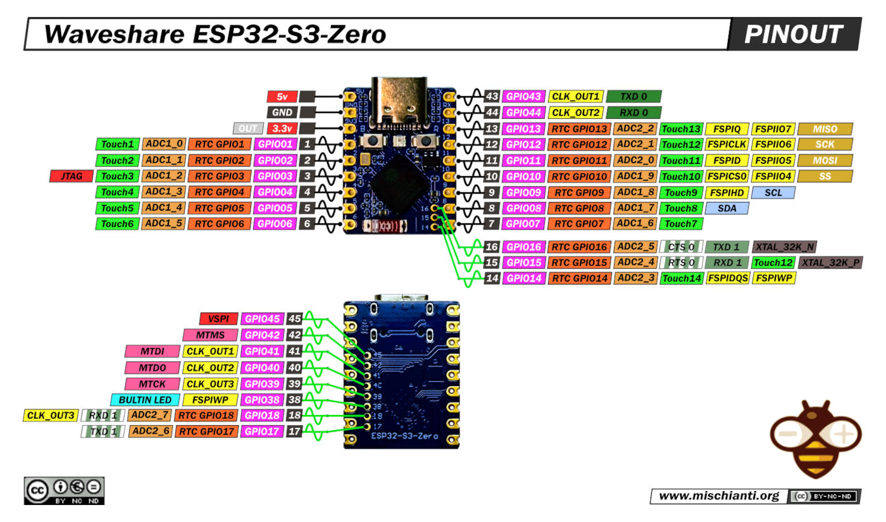

# MecSveglia — ESP32-S3 Zero clock/desk companion

- Piattaforma: ESP32‑S3 (Waveshare ESP32‑S3‑Zero)
- Display: OLED SSD1306 128×32 I2C (addr 0x3C)
- Funzioni: ora via NTP con fuso configurabile, meteo OpenWeatherMap, notizie RSS ANSA, pagine web su filesystem, mDNS, OTA, animazioni (occhi, Game of Life, triangolo), ciclo schermi automatico, attenuazione notturna.

Pinout della board: vedi immagine in `info/esp32-S3-Zero-Waveshare-pinout-low.jpg`.



## Requisiti

- VS Code + PlatformIO (framework Arduino)
- Librerie auto‑gestite da PlatformIO: `Adafruit SSD1306`, `Adafruit GFX`, `ArduinoJson` **v6**, `Adafruit NeoPixel`

## Struttura progetto

- Codice sorgente: `src/`
- File web e configurazione su filesystem: `data/`
- Definizione scheda: `board/esp32-s3-fh4r2.json`
- Pinout: `info/`
- Regressioni host e controllo partizioni OTA: `test/`
- Modelli per stampa 3D: `stl/` (`stl/mac01.stl`, `stl/mac02.stl`)

## Funzionalità

- **Interfaccia web rinnovata**: Tema scuro con accenti menta, schede responsive, comandi con icone e anteprima OLED adattiva. Funziona senza font o librerie esterne.
- **Multitasking FreeRTOS**: RSS e meteo vengono aggiornati in un task di rete separato dal rendering del display.
- **Filesystem SPIFFS**: Nel codice è chiamato `LittleFS` tramite `#define LittleFS SPIFFS`; non si tratta di una migrazione al formato LittleFS.
- **RSS a memoria limitata**: Parsing incrementale con limiti di input e timeout; conserva fino a cinque titoli e mantiene l'ultima cache valida su errore.
- **Thread safety**: Dati RSS/meteo protetti da mutex e notifica SNTP atomica; rendering e invio HTTP avvengono fuori dai lock.
- **Game of Life migliorato**: Inizializzazione casuale ad ogni avvio; rilevamento stasi (grid statica, oscillatori periodici, estinzione) con iniezione automatica di blinker casuali per mantenere la simulazione viva.
- **Ciclo schermi ON/OFF**: Il pulsante "Ciclo schermi" evidenzia lo stato attivo e diventa "Ferma ciclo". Selezionare una schermata specifica disattiva il ciclo.
- **Aggiornamenti di rete**: RSS ogni ora e meteo ogni 30 minuti. In caso di errore, i dati validi restano disponibili e il tentativo viene ripetuto dopo 60 secondi.
- **OTA firmware e filesystem**: Due slot firmware alternati, watchdog alimentato durante il progresso e tentativo di rimontaggio non distruttivo dopo un errore OTA filesystem.

## Configurazione scheda in PlatformIO

Il progetto include la board `esp32-s3-fh4r2` (4 MB flash QIO + 2 MB PSRAM)
in `board/esp32-s3-fh4r2.json`. `platformio.ini` configura già:

```ini
[platformio]
boards_dir = board
```

Non occorre installare definizioni di board esterne.

### File `platformio.ini`

- Ambiente attivo: `[env:esp32-s3-fh4r2]`
- Piattaforma: `espressif32`
- Framework: `arduino`
- Filesystem: **SPIFFS**, con alias `LittleFS` nel codice e partizioni da `partitions.csv`
- Flag principali: USB CDC su boot abilitato

## Compilazione e caricamento

Esegui i comandi dal terminale PlatformIO, nella radice del repository:

| Operazione | Comando |
|---|---|
| Compila firmware | `pio run` |
| Carica firmware via USB | `pio run --target upload` |
| Genera immagine filesystem | `pio run --target buildfs` |
| Carica filesystem via USB | `pio run --target uploadfs` |
| Monitor seriale (115200 baud) | `pio device monitor` |

Se necessario, specifica la porta con `--upload-port <PORTA_USB>`.
Per aggiornare la grafica basta caricare il filesystem: non serve riscrivere il
firmware se il layout delle partizioni è già quello corrente.

**Attenzione: `uploadfs` sostituisce tutto il filesystem, non solo le pagine web.**
Prima del caricamento, salva i file attuali del dispositivo e prepara l'immagine
con la configurazione da conservare. I file presenti in `data/` potrebbero non
riflettere le ultime impostazioni salvate dall'interfaccia web.

## OTA e migrazione delle partizioni

La flash da 4 MB contiene due slot firmware alternati e il filesystem SPIFFS
(chiamato `LittleFS` dal codice):

| Partizione | Offset | Dimensione |
|---|---|---|
| `app0` (`ota_0`) | `0x10000` | 1792 KiB |
| `app1` (`ota_1`) | `0x1D0000` | 1792 KiB |
| `spiffs` | `0x390000` | 448 KiB |

**La prima migrazione dal vecchio layout con un solo slot richiede USB, non OTA.**
Il filesystem cambia offset e passa da 2 MiB a 448 KiB:

1. Prima di caricare qualsiasi immagine, salva privatamente il filesystem
   attuale del dispositivo e recupera i file di configurazione aggiornati.
   `/config` non include password e chiave meteo; i file locali potrebbero
   essere meno recenti di quelli sul dispositivo. Non pubblicare credenziali.
2. Prepara `data/` con pagine e configurazione da conservare. Non riscrivere il
   vecchio backup raw da 2 MiB nel nuovo layout: ricostruisci l'immagine dai file.
3. Esegui `pio run --target upload --upload-port <PORTA_USB>` per caricare
   firmware, bootloader e nuova tabella delle partizioni.
4. Esegui `pio run --target uploadfs --upload-port <PORTA_USB>` per caricare il
   filesystem ricostruito. Verifica Wi-Fi e pagine prima degli OTA successivi.

Non serve cancellare tutta la flash. Gli aggiornamenti ArduinoOTA successivi
scrivono lo slot inattivo; non viene aggiunto rollback automatico. Gli OTA
filesystem sovrascrivono pagine e configurazione: conserva sempre un backup.

Su macOS ARM, se `buildfs` termina con `Bad CPU type in executable`, il pacchetto
`tool-mkspiffs` installato contiene un eseguibile Intel: serve Rosetta oppure un
`mkspiffs` nativo compatibile con ESP32 Arduino (metadata SPIFFS di 4 byte).

## Configurazione in `data/`

- `INDEX.HTM` pagina principale (home)
- `SETUP.HTM` pagina di configurazione Wi‑Fi/mdns
- `WIFI_SID.TXT` e `WIFI_PWD.TXT` credenziali Wi‑Fi
- `MDNS_NM.TXT` nome mDNS/SSID AP di fallback (default `MECSVEGLIA`)
- `SCREEN.TXT` numero schermo di avvio (0..7, opzionale)
- `TIME_ZONE.TXT` fuso POSIX (default `CET-1CEST,M3.5.0/2,M10.5.0/3`)
- `RSS.TXT` categoria ANSA (es. `tecnologia`, `mondo`, `sport`)
- `METEO_API.TXT` query string di OpenWeatherMap dopo il `?` (esempio: `id=3175384&cnt=1&units=metric&lang=it&appid=XXXX`)

Le impostazioni modificate dai form vengono scritte subito sul filesystem.
Non pubblicare password Wi-Fi o chiavi API reali nel repository o nei log.

## Uso rapido

- Avvio in STA: con credenziali valide sul filesystem, il dispositivo si collega al Wi‑Fi e risponde a `http://<mdns>.local` (es. `http://MECSVEGLIA.local`).
- Fallback AP: se mancano credenziali o la rete non è disponibile, crea un AP aperto con SSID `<mdns>` e mostra l’IP sul display.
- Il task di rete gestisce la riconnessione Wi-Fi e il ritorno da AP a STA quando sono presenti credenziali valide.

### Interfaccia web

- **Pannello `/`**: selezione delle schermate, reset Game of Life, ciclo automatico e stato del dispositivo. L'anteprima OLED si aggiorna manualmente oppure ogni 0,5 secondi attivando la casella Auto.
- **Impostazioni**: schermata di avvio, categoria RSS con anteprima dei titoli e fuso orario POSIX.
- **Rete e Wi-Fi `/setup`**: SSID, password e nome mDNS; il salvataggio riavvia la scheda. La password non viene mostrata: reinseriscila per una rete protetta, oppure lascia vuoto soltanto per una rete aperta.

Il layout si adatta a desktop e smartphone, con focus visibile da tastiera e
controlli touch. Dopo un aggiornamento delle pagine, ricarica senza cache
(`Cmd+Shift+R` su macOS o `Ctrl+F5` su Windows/Linux).

### Endpoint principali

| Endpoint | Funzione |
|---|---|
| `/`, `/setup` | Pannello e configurazione Wi-Fi |
| `/config` | SSID e nome mDNS, senza password |
| `/status` | Stato rete, schermata, ciclo e diagnostica |
| `/wifi`, `/time`, `/eyes`, `/meteo`, `/gol`, `/tri`, `/rssscreen` | Selezione schermata |
| `/golreset` | Reinizializza Game of Life |
| `/cycle` | Alterna il ciclo e restituisce `{"cycle": true/false}` |
| `/oled` | Framebuffer OLED in JSON |
| `/screen/start`, `/rss`, `/timezone` | GET impostazioni; POST salvataggio |

## Hardware

- Display SSD1306 I2C 128×32 a 3.3V, indirizzo 0x3C (default). Collega SDA/SCL ai pin I2C della board come da pinout.
- Pulsante su `GPIO12` in modalità pull‑up interna: collega a GND per avanzare manualmente tra gli schermi.

## Diagnostica e verifiche

`/status` espone `reset_reason`, `uptime_ms`, heap libero (`free_heap`), minimo
storico (`min_free_heap`), massimo blocco allocabile (`max_alloc_heap`) e margini
minimi degli stack (`loop_stack_min`, `network_stack_min`). Le misure di memoria
sono espresse in byte; il pannello web visualizza quelle disponibili in KiB.

Un reset **BROWNOUT** indica un problema di tensione rilevato dal chip:
controlla cavo, porta o hub USB, alimentazione a 3,3 V e carico delle periferiche.
Non disabilitare la protezione per mascherarlo. Timeout di rete e reset richiedono
misure sul dispositivo: non dimostrano da soli un memory leak.

### Regressioni locali

```bash
pio run
sh test/run_host_tests.sh
pio run --target buildfs
python3 test/check_ota_layout.py
```

I test host richiedono Python 3 e un compilatore C++11 con AddressSanitizer e
UndefinedBehaviorSanitizer; riutilizzano ArduinoJson installato da PlatformIO.
Coprono parsing e timeout, conservazione cache, retry e rollover, animazioni,
sostituzione dei placeholder HTML, credenziali e callback SNTP/OTA.
Il controllo OTA verifica layout e capienza delle immagini compilate.

Non richiedono una scheda e non sostituiscono prove reali di alimentazione,
frammentazione heap, stack, I2C, rete o OTA interrotta. Dettagli in [`test/README`](test/README).

## Stampa 3D

- I modelli sono nella cartella `stl/`. Scegli l’alloggiamento più adatto (`mac01.stl`, `mac02.stl`) e stampa con materiale a tua scelta.

## Note

- Il progetto abilita OTA: gli aggiornamenti possono essere inviati via rete quando il dispositivo è connesso.
- Il display si attenua di notte (22:00–06:59) tramite `display.dim(true)`.
- L'inversione periodica anti burn‑in è disabilitata.
